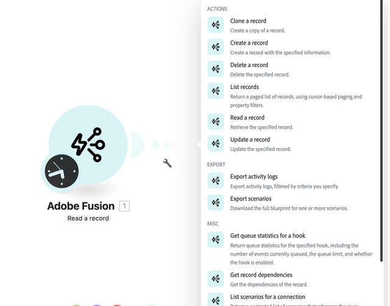
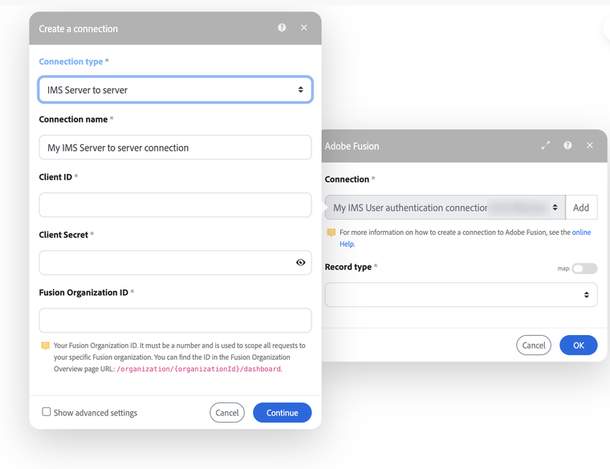

# Authentication

Authenticate Workfront Fusion API requests with Adobe IMS access tokens.

## Overview

Every Workfront Fusion API request must include an access token from [Adobe Identity Management System (IMS)](https://developer.adobe.com/developer-console/docs/guides/authentication/). The API supports both IMS token types:

* **User authentication:** requests run as a Fusion user and have that user's access.
* **Server-to-server:** requests run as a **technical account** and have the access you grant it. Recommended for production, unattended and organization-wide integrations.

This page covers server-to-server authentication. For user tokens, see [IMS user authentication](https://developer.adobe.com/developer-console/docs/guides/authentication/UserAuthentication/).

## Setup at a glance

| Step | Where | Result |
|---|---|---|
| **1. [Create credentials](../credentials/index.md)** | Adobe Developer Console | Client ID, Client Secret and Technical Account Email |
| **2. [Give the technical account access](../technical_accounts/index.md)** | Workfront Fusion, plus the Adobe Admin Console for organization-wide access or admin-level actions | The technical account can reach the teams, or the whole organization, that you choose |
| **3. Connect** | Your code or a Fusion scenario | [Call the REST API](#call-the-rest-api) or [use the Adobe Fusion connector](#use-the-adobe-fusion-connector) |

A new technical account has no team or role, so its requests return empty results until you complete step 2.

## Call the REST API

Use this option to call the API from your own server-side application. Complete [step 1](../credentials/index.md) and [step 2](../technical_accounts/index.md) first.

### 1. Request an access token

Exchange your Client ID and Client Secret for an access token:

```bash
export FUSION_CLIENT_ID=<your_client_id>
export FUSION_CLIENT_SECRET=<your_client_secret>

curl --location 'https://ims-na1.adobelogin.com/ims/token/v3' \
--header 'Content-Type: application/x-www-form-urlencoded' \
--data-urlencode 'grant_type=client_credentials' \
--data-urlencode "client_id=$FUSION_CLIENT_ID" \
--data-urlencode "client_secret=$FUSION_CLIENT_SECRET" \
--data-urlencode 'scope=openid,AdobeID,profile,additional_info.projectedProductContext'
```

Response:

```json
{"access_token":"yourExampleToken","token_type":"bearer","expires_in":86399}
```

Tokens are valid for **24 hours**. `expires_in` gives the remaining lifetime in seconds. Cache the token, reuse it across requests, and request a new one shortly before it expires. Don't request a new token for every API call.

### 2. Call the API

Send the token with these headers on every request:

| Header | Value |
|---|---|
| `Authorization` | `Bearer <access_token>` |
| `x-api-key` | Your Client ID |
| `x-gw-region` | Your Fusion region, for example `or2` |
| `x-organization-id` | Your numeric Fusion organization ID |

If you don't know your region and organization ID yet, call the regions endpoint. It needs only the token:

```bash
export FUSION_ACCESS_TOKEN=<your_access_token>

curl --location 'https://app.workfrontfusion.com/api/v3/users/me/regions' \
--header "Authorization: Bearer $FUSION_ACCESS_TOKEN"
```

See [API Headers](../api_headers/index.md) for details on each header and the error responses.

## Use the Adobe Fusion connector

Use this option to work with your Fusion organization from inside a scenario, without writing code or managing tokens. The connector's modules cover the same resources as the [Fusion API](../../api/index.md):

| Group | Modules |
|---|---|
| **Actions** | Clone, Create, Delete, List, Read and Update a record |
| **Export** | Export activity logs, Export scenarios (full blueprints) |
| **Misc** | Get queue statistics for a hook, Get record dependencies, List scenarios for a connection, and more |

In most modules, you first pick a **Record type**, such as scenarios, connections or hooks.



### Choose a connection type

| Connection type | Runs as | Can access |
|---|---|---|
| **IMS User authentication** | The Fusion user who creates the connection | What that user can access |
| **IMS Server to server** | The technical account | What you granted in [step 2](../technical_accounts/index.md#choose-an-access-level): specific teams or the whole organization |

Use **IMS Server to server** for organization-wide or unattended scenarios, such as audits, backups and control centers. That way the scenario doesn't depend on one person's account.

### Create a server-to-server connection

Complete [step 1](../credentials/index.md) and [step 2](../technical_accounts/index.md) first.

1. In a scenario, add any **Adobe Fusion** module.
2. Next to **Connection**, click **Add**.
3. Set **Connection type** to **IMS Server to server**.
4. Fill in the fields as described in the following table.
5. Click **Continue**.

| Field | Value |
|---|---|
| **Connection name** | A descriptive label, for example `Fusion Admin (S2S)` |
| **Client ID** | From the credential's [Credential details](../credentials/index.md#collect-the-credential-details) tab |
| **Client Secret** | From the same tab (**Retrieve client secret**) |
| **Fusion Organization ID** | The number in your Fusion **Org overview** URL, `.../organization/{organizationId}/dashboard`. Not the `...@AdobeOrg` ID. |



<InlineAlert variant="warning" slots="text" />

Anyone who can edit a scenario can use its connections with the technical account's access. Limit who can edit scenarios that use an Organization Owner connection.

### Verify the connection

Run a list module once, for example **List records** for scenarios. You should see scenarios from the whole organization (Organization Owner) or from the teams you added the technical account to. If you get no results or an error, see [Troubleshooting](#troubleshooting).

## Security best practices

* Store the Client Secret securely, for example in a secrets manager. Never share it in code, email or chat.
* If the Client Secret is exposed, rotate it on the credential's **Credential details** tab in the Developer Console.

## Troubleshooting

| Symptom | Fix |
|---|---|
| Requests succeed but return no scenarios or data | The technical account has no access. Add it to teams or make it an Organization Owner ([step 2](../technical_accounts/index.md#choose-an-access-level)). |
| Activity log or export operations are denied, or you can't set the role to **Owner** | Make the technical account an admin on the **Production** Workfront Fusion product in the Admin Console ([step 2](../technical_accounts/index.md#1-grant-admin-access-in-the-adobe-admin-console)). |
| Token request or connection fails to authenticate | Check the Client ID and Client Secret for extra spaces, or retrieve the secret again. For the connector, use the numeric Fusion Organization ID, not the `...@AdobeOrg` ID. |
| Adobe Fusion API is missing from the project | Add the **Adobe Fusion** API to the same project as the credential ([step 1](../credentials/index.md#create-the-project-and-credential)). |
| `400`, `401` or `403` errors | See [Common error responses](../api_headers/index.md#common-error-responses). |

**Next:** Explore the endpoints in the [API Reference](../../api/index.md).
