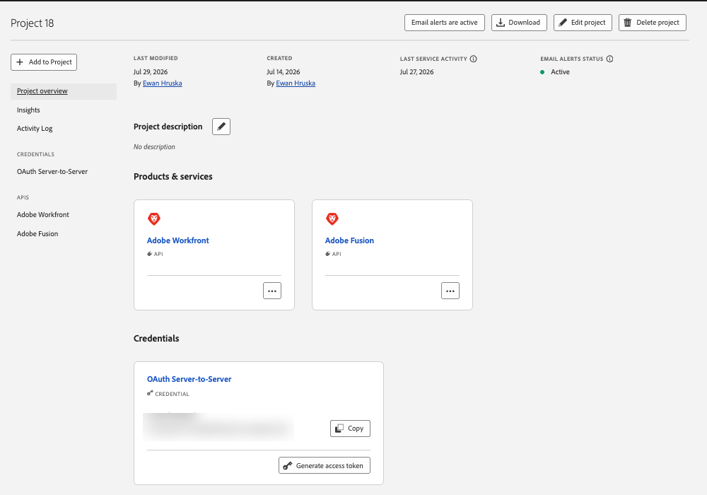
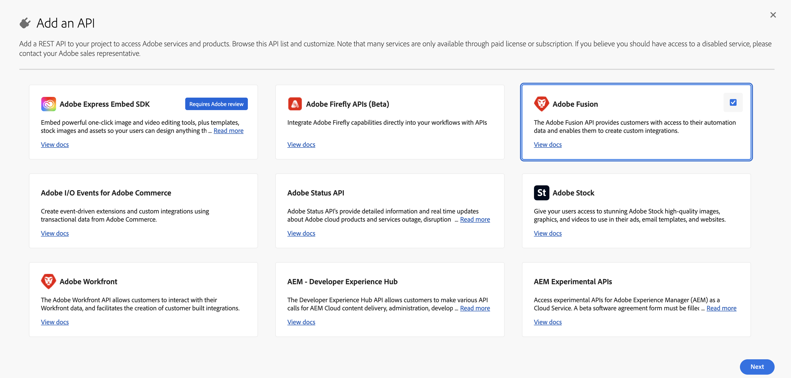
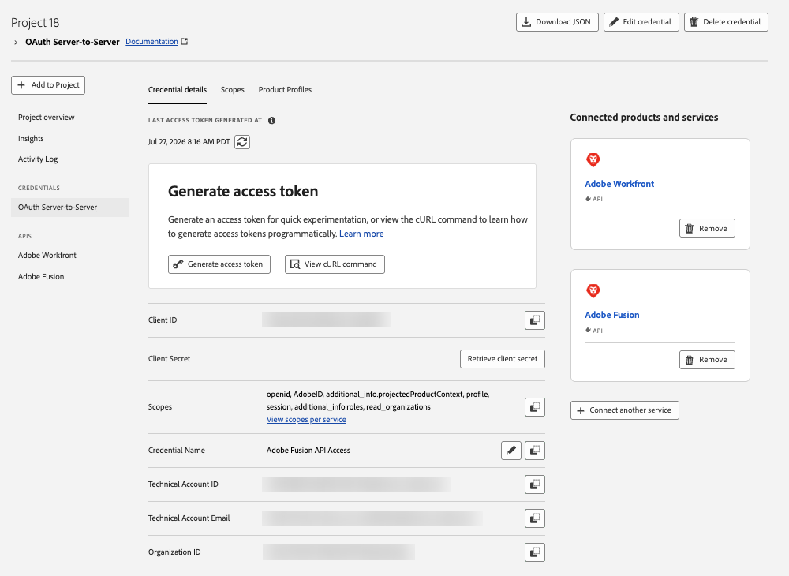
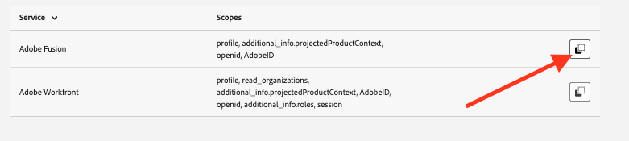

# Step 1: Create Credentials

Create the OAuth Server-to-Server credential for your technical account.

## Overview

Create an **OAuth Server-to-Server** credential in the Adobe Developer Console. This credential provisions the **technical account** that you use everywhere else: when calling the Fusion API directly and when creating an Adobe Fusion connector connection inside a scenario.

<InlineAlert variant="info" slots="text" />

This page is for **organization admins** who create project credentials for their teams. If your admin has already shared a Client ID and Client Secret with you, skip to [Authentication](../authentication/index.md).

**Where this fits:** **1. Create credentials** → 2. [Give the technical account access](../technical_accounts/index.md) → 3. [Call the API](../authentication/index.md#call-the-rest-api) or [use the Adobe Fusion connector](../authentication/index.md#use-the-adobe-fusion-connector)

## Before you begin

* Developer access to the [Adobe Developer Console](https://developer.adobe.com/console).
* An organization that has a Workfront Fusion product license.

<InlineAlert variant="warning" slots="text" />

Can't find the Adobe Fusion API? Make sure you are signed in to the Developer Console under the organization that has the Workfront Fusion product license.

## Create the project and credential

1. Go to the [Adobe Developer Console](https://developer.adobe.com/console) and open an existing project, or create a new one.
2. Click **Add to Project**, then select **API**.
3. Select **Adobe Fusion**. This grants access to scenarios, blueprints and other Fusion resources.
   * *Optional:* also add **Adobe Workfront** if you want the same credential to write results back to Workfront.
4. On the **Select authentication type** screen, choose **OAuth Server-to-Server**, then click **Next**.
5. Give the credential a clear name (for example, `Adobe Fusion API Access`), click **Next**, then click **Save configured API**.
6. If your organization has multiple Fusion instances, select the instance that the credential should be associated with.

When you're done, the project overview lists **Adobe Fusion** (and **Adobe Workfront**, if added) under **Products & services**, and the **OAuth Server-to-Server** credential under **Credentials**.



**Shortcut:** You can also go to **API and services**, search for **Adobe Fusion**, and click **Create project** on the product card. It creates a project with the Fusion API and an OAuth Server-to-Server credential in one step.



## Collect the credential details

In the project, select **OAuth Server-to-Server** in the left navigation and open the **Credential details** tab. Note these values. You'll need them in the next steps:

| Value | Where it's used |
|---|---|
| **Client ID** | Requesting an access token, the `x-api-key` header, and the Adobe Fusion connector connection |
| **Client Secret** (click **Retrieve client secret**) | Requesting an access token and the Adobe Fusion connector connection |
| **Organization ID** (`...@AdobeOrg`) | Identifies your Adobe (IMS) organization |
| **Technical Account Email** (ends in `@techacct.adobe.com`) | Finding the technical account in the Admin Console and in Fusion ([Step 2](../technical_accounts/index.md)) |



<InlineAlert variant="warning" slots="text" />

**Treat the Client Secret like a password.** The Client ID and Organization ID are identifiers, but the Client Secret grants access. Store it securely (for example, in a secrets manager), and never paste it into email, chat or client-side code. If it's ever exposed, rotate it from this same screen.

## Check the scopes

On the **Scopes** tab, confirm that each service you added has scopes. The Fusion API token request uses `openid,AdobeID,profile,additional_info.projectedProductContext`. Use the copy control next to a service if you need to record its scope string.



## Share credentials with developers

To call the Fusion API, developers need a **Client ID** and an **access token**. Only organization admins can open these projects in the Console, so the **Generate access token** button isn't a practical way to share access. Access tokens also expire every 24 hours.

<InlineAlert variant="info" slots="text" />

Share the **Client ID** and **Client Secret** securely instead of access tokens. Developers can then generate new tokens programmatically whenever they need them.

To give developers a ready-made token request:

1. In the **Generate access token** block, select **View cURL command**.
2. Copy the command and share it with developers in your organization. It looks similar to this:

```bash
curl -X POST 'https://ims-na1.adobelogin.com/ims/token/v3' \
-H 'Content-Type: application/x-www-form-urlencoded' \
-d 'grant_type=client_credentials&client_id={client_id}&client_secret={client_secret}&scope=openid,AdobeID,profile,additional_info.projectedProductContext'
```

## Next step

A new technical account **can't see any scenarios yet**. Continue to [Step 2: Give the technical account access](../technical_accounts/index.md).
