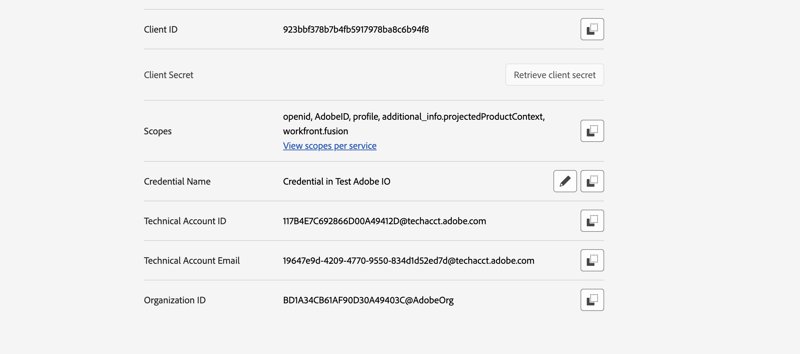
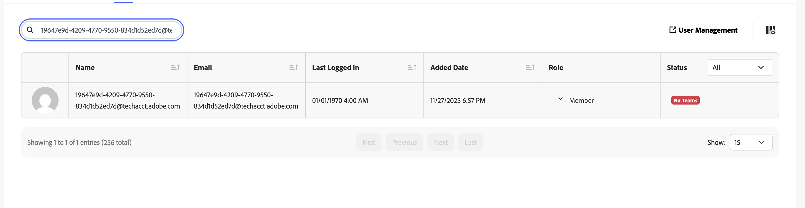
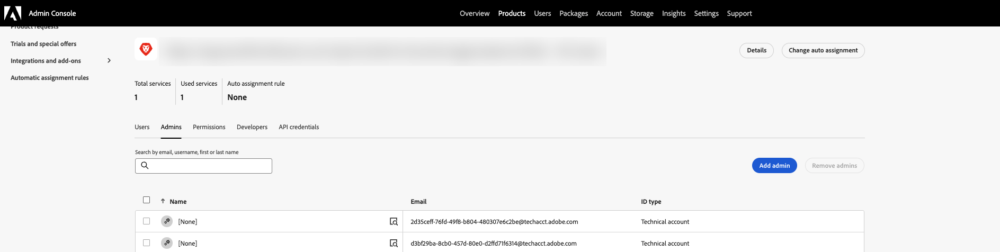
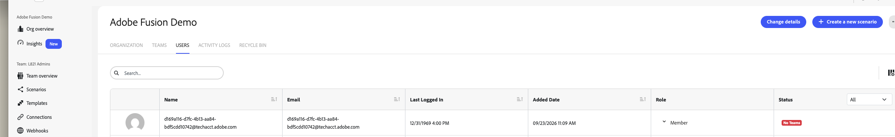

# Step 2: Give the Technical Account Access

Choose what the technical account can reach in Workfront Fusion, and grant that access.

## Overview

**Where this fits:** 1. [Create credentials](../credentials/index.md) → **2. Give the technical account access** → 3. [Call the API](../authentication/index.md#call-the-rest-api) or [use the Adobe Fusion connector](../authentication/index.md#use-the-adobe-fusion-connector)

When you create an OAuth Server-to-Server credential, a technical account is added to your Fusion organization as an **organization member on no team**. **By default it can't see anything.** Requests authenticate, but they return little or no data.

## Choose an access level

| | Option 1: Team access | Option 2: Organization-wide access |
|---|---|---|
| **Use when** | The integration only needs **specific teams** | The integration must reach **every team**, for example a control center that lists or exports all scenarios |
| **Reaches** | Scenarios and data in the teams you add it to | Scenarios and data across the whole organization |
| **Fusion role** | Team member | Organization Owner |
| **Admin access in the Adobe Admin Console** | Not required. Add it only for [admin-level actions](#optional-allow-admin-level-actions) | Required |
| **Principle** | Least privilege | Broad access, simpler to manage |

**Admin-level actions**, such as viewing and exporting activity logs, always need admin access in the Adobe Admin Console. Option 2 already includes it. With Option 1, add it as an [optional extra step](#optional-allow-admin-level-actions).

<InlineAlert variant="info" slots="text" />

Admin access on its own doesn't give access to scenarios or data. The technical account must also be a team member (Option 1) or an Organization Owner (Option 2).

## Before you begin

* Rights to manage teams and organization roles in Workfront Fusion.
* For Option 2, or for admin-level actions: **System Administrator** access to the [Adobe Admin Console](https://adminconsole.adobe.com). If you don't have it, ask your organization administrator.
* The **Technical Account Email** from [Step 1](../credentials/index.md#collect-the-credential-details). It ends in `@techacct.adobe.com`. You use it to find the technical account in Fusion and in the Admin Console.

The technical account email is shown on the project's **Credential details** tab in the Adobe Developer Console. For example, `19647e9d-4209-4770-9550-834d1d52ed7d@techacct.adobe.com`:

Fusion creates the matching user automatically. It's listed in **Org overview** > **Users** with the role **Member** and the status **No Teams**:

## Option 1: Team access

Use this option when the integration only needs specific teams. No admin access is required.

### Add the technical account to teams

1. In Fusion, open the **Teams** tab and select the target team.
2. Add the technical account user with the right team permissions.
3. Repeat for each team whose scenarios the integration must reach.

### Optional: Allow admin-level actions

If the integration also needs admin-level actions, such as viewing and exporting activity logs, make the technical account an admin in the Adobe Admin Console. Follow [Grant admin access in the Adobe Admin Console](#1-grant-admin-access-in-the-adobe-admin-console). You don't need to change its Fusion role.

## Option 2: Organization-wide access

Use this option when the integration must reach every team. It takes two steps, in order: first make the technical account an admin, then give it the Organization Owner role. Only admins can be given the Organization Owner role. This option also covers admin-level actions such as activity logs.

### 1. Grant admin access in the Adobe Admin Console

1. Go to [adminconsole.adobe.com](https://adminconsole.adobe.com) and open the **Products** tab.
2. Select **Workfront Fusion**. Open the correct organization instance and its product profile. If you're prompted, choose your **Production** instance.
3. Select the **Admins** tab and click **Add admin**.
4. Enter the **Technical Account Email** and click **Save**.

The technical account now appears as an admin with the ID type **Technical account**.

<InlineAlert variant="info" slots="text" />

The technical account **doesn't appear in the product's Users list**, even though it exists in Fusion. Add it directly from the **Admins** tab.

For more details, see [Add users to Adobe Workfront Fusion through the Adobe Admin Console](https://experienceleague.adobe.com/en/docs/workfront-fusion/using/set-up-and-manage-fusion/set-up-and-manage-orgs-and-teams/set-up-orgs-teams-and-users/add-fusion-users-admin-console).

### 2. Make it an Organization Owner

1. In Fusion, open **Org overview**, then the **Users** tab.
2. Find the technical account by its `@techacct.adobe.com` address. It shows as **Member** with **No Teams**.
3. Set its **Role** to **Owner**.

## Next step

The technical account is ready. Choose how you want to use it:

* **Call the REST API** from your own code: [generate an access token](../authentication/index.md#call-the-rest-api), then add the [required headers](../api_headers/index.md).
* **Work inside a Fusion scenario:** [create an Adobe Fusion connector connection](../authentication/index.md#use-the-adobe-fusion-connector).
